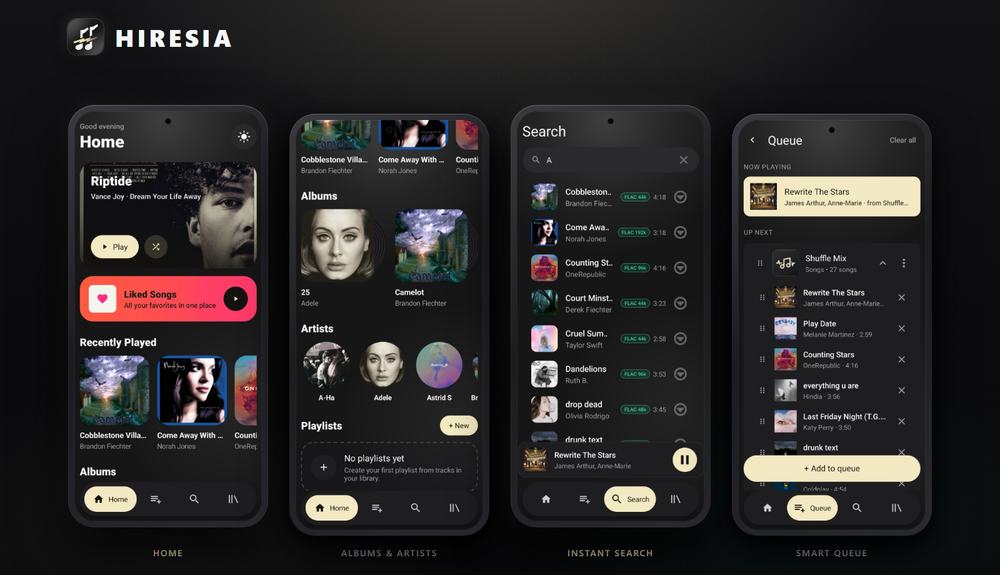

<div align="center">

# Hiresia

**Standalone Bit-Perfect Hi-Res Audio Player for Android**

Powered by a custom **C++20 NDK native audio engine** (`libusbaudioengine.so`) with direct **UAC1/UAC2 USB DAC** output, **AAudio Exclusive HAL**, native lossless & **DSD/DoP 1.1** decoders, and **64-bit DSP**.

<p>
  
  
  
  
</p>

<br />



</div>

---

## What it does

- **Bit-Perfect C++20 Audio Engine** — Bypasses the Android AudioFlinger mixer and software DSP when Bit-Perfect mode is enabled, sending bit-exact PCM/DSD streams straight to your DAC.
- **Direct USB Audio Class Driver (`UAC1` & `UAC2`)** — Custom userspace native USB driver over Android USB Host / Linux `usbdevfs` with isochronous transfers, automatic hotplug detection, debounced detach recovery, and hardware Feature Unit volume (`UAC_SET_CUR`).
- **Direct AAudio Exclusive HAL** — Low-latency exclusive output path for internal DACs and wired headphones with automatic stream recovery on route transitions.
- **Native Lossless & Hi-Res Decoders** — Native C/C++ decoding for **FLAC, WAV, ALAC (MP4/M4A), WavPack (PCM/Float/DSD), TTA, DSD (DSF/DFF), Ogg Vorbis, and MP3**, plus a high-precision windowed **Sinc Resampler**.
- **DSD & DoP 1.1 Engine** — Choose between **Native DSD**, **DoP 1.1** (`0x05/0xFA` markers), or high-precision FIR **DSD-to-PCM** decimation.
- **64-Bit Audiophile DSP Suite** — 10-band Orfanidis symmetrical Parametric EQ (`-15 dB` to `+15 dB`) with AutoEQ text import, dynamic **AutoGain** anti-clipping, Bauer / Chu-Moy **Binaural Crossfeed**, Channel Balance, **TPDF Dither**, and **ReplayGain**.
- **Audiophile Volume System** — Hardware DAC, Software, Auto, and Fixed line-out modes with Linear, Perceptual Cubic, and Logarithmic (`-96 dB` to `0 dB`) curves plus built-in DAC hearing safety limits.
- **Signal Path Inspector & Stereo VU Meter** — Real-time audio pipeline bottom sheet and LED bargraph stereo VU meter (`VUMeterView`).
- **Fast SQLite Library & Live Lyrics** — Indexed SQLite library (`Folder`, `Song`, `Album`, `Artist`, `Genre`, `Composer`, `Playlist`), album-grouped Queue, Sleep Timer, Lockscreen `MediaSession`, Home Widget, and HTTPS synced lyrics via [LRCLIB](https://lrclib.net/).
- **Obsidian Gold UI & Instant Bilingual Support** — Ships with **Obsidian Gold (Dark)**, **Zest Light**, and **Aegean Light** palettes plus instant in-app **English ↔ Bahasa Indonesia** switching.

> For the complete technical breakdown of every module and setting, see **[FEATURES.md](FEATURES.md)**.

---

## Tech & Build

**Stack:** Kotlin + AndroidX / ViewBinding + Jetpack Media3 + Glide on top of a custom **C++20 NDK** engine (`libusbaudioengine.so`) targeting `arm64-v8a`, `armeabi-v7a`, and `x86_64` (`minSdk 26`, `targetSdk 34`).

### Prerequisites
- **JDK 17** (or compatible JDK for Gradle 8.7)
- **Android SDK 34** + **Android NDK** + **CMake 3.22.1**

### Build from Source

```bash
git clone https://github.com/RyntDev/hiresia.git
cd hiresia
./gradlew assembleDebug
```

*(On Windows PowerShell: `.\gradlew.bat assembleDebug`)*

For a R8-shrunk release APK, copy [keystore.properties.example](keystore.properties.example) to `keystore.properties` (gitignored), add your release keystore details, and run:

```bash
./gradlew assembleRelease
```

---

## Documentation

- **[FEATURES.md](FEATURES.md)** — Full feature specification across engine, decoders, DSP, volume system, and UI
- **[CHANGELOG.md](CHANGELOG.md)** — Version history and release notes
- **[THIRD_PARTY_LICENSES.md](THIRD_PARTY_LICENSES.md)** — Open-source attributions & license texts (ALAC, WavPack 5.7.0, `dr_libs`, `stb_vorbis`, AndroidX, Glide)
- **[SECURITY.md](SECURITY.md)** — Offline-first privacy policy and private vulnerability reporting

---

## Privacy & Network

Hiresia works **100% offline** for local audio playback with **zero accounts, analytics, or telemetry**. `android:usesCleartextTraffic="false"` is enforced app-wide. When you request online synced lyrics, `LiveLyricsManager` sends only the track **title**, **artist**, and **duration** over HTTPS to [LRCLIB](https://lrclib.net/).

---

## Feedback & Support

- **Found a bug or have an idea?** Open a [GitHub Issue](../../issues) or submit a private report (with optional screenshots/audio samples up to 10 MB, no GitHub account needed) via the **[Bug Report & Feedback Form](https://docs.google.com/forms/d/e/1FAIpQLSfe809fZb4Sg_37t5HjpQ0gW2WjYzNYuhyE4QPkKRHKc0DDBw/viewform)**.
- **Support Development:** [Support RyntDev on SociaBuzz](https://sociabuzz.com/rynodev/tribe)

---

## License

Licensed under the **[MIT License](LICENSE)** — Copyright (c) 2026 RyntDev (Hiresia).
